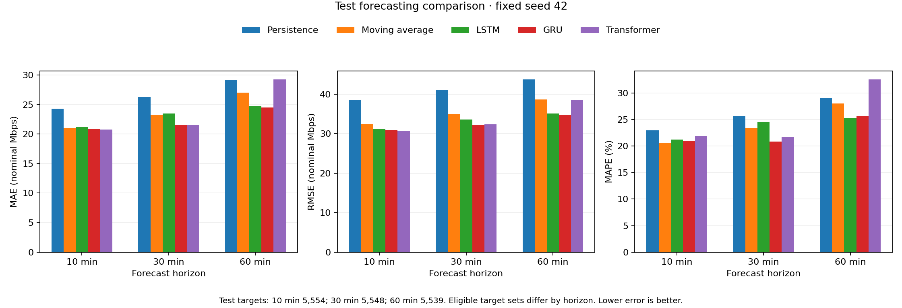

# LSTM Based Internet Traffic Forecasting for Intelligent Bandwidth Prediction in Cloud ISP and Data Center Networks

Final academic project report

22 October 2026

## Abstract

This project implements a reproducible pipeline for forecasting recorded Internet traffic and evaluating proactive capacity allocation. The experiment uses institution 0 from CESNET-TimeSeries24 version v1, with ten-minute observations and three hours of historical inputs. Persistence and a four-observation moving average are compared with compact LSTM, GRU and Transformer models at direct forecast horizons of 10, 30 and 60 minutes. Chronological evaluation, training-only scaling and explicit exclusion of suspect measurement periods control avoidable leakage.

On the held-out test data, Transformer achieves the lowest ten-minute RMSE at 30.803 Mbps. GRU achieves the lowest thirty-minute and sixty-minute RMSE at 32.290 and 34.785 Mbps. LSTM remains competitive but does not win every forecasting comparison. These are descriptive results for one institution and one fixed seed, without confidence intervals.

In the ten-minute allocation simulation, LSTM with a 20% margin has shortfalls in 10.86% of test intervals, compared with 23.44% for reactive allocation. Its mean allocated capacity is 148.67 Mbps versus 140.21 Mbps for reactive allocation. Lower shortfall therefore comes with additional capacity. None of the five policies meets the target of at most 1% shortfall intervals on validation at the tested margins, so 20% is a disclosed fallback.

### Experimental scope

The deliverable is an offline research prototype with saved forecasts, model checkpoints, result tables, a local dashboard and a reproducible workflow. The recorded traffic target is an institution-level nominal rate. Cloud and data-center deployment are proposed extensions; physical-link utilization, packet loss and latency improvements are not measured here.

## Problem statement and related research

Bandwidth provisioning must trade unused capacity against demand that exceeds available capacity. A reactive rule uses the latest measurement and can lag a sudden change. A forecasting model can use recent temporal patterns to estimate upcoming demand, but an improved average forecast error does not automatically imply a reliable capacity policy. This study evaluates prediction and allocation separately so that both benefits and costs remain visible.

### Research questions

The experiment asks whether compact neural models improve on simple predictors for the same future targets; how performance changes with forecast lead; and whether a forecast-based capacity rule reduces shortfall at identical margins. The study also examines whether the validation-selected policy can achieve a stated reliability requirement before reporting performance on held-out observations.

### Model foundations

Hochreiter and Schmidhuber introduced LSTM to address difficulties learning information over long time lags in recurrent networks [3]. The implemented PyTorch LSTM is a modern gated recurrent layer, used here to encode an observed traffic window and produce one scalar forecast. This project does not reproduce the original paper's artificial-sequence experiments.

Cho et al. proposed a recurrent encoder-decoder with gated hidden units in machine translation [4]. GRU provides a compact recurrent alternative in this study. Vaswani et al. introduced a Transformer based on attention [5]. Here a small encoder-only adaptation attends to historical traffic features; it is not the original translation architecture. These publications motivate model families, while all traffic accuracy claims in this report come from the local experiments.

### Deliverable requirements

| Requirement | Implementation |
| --- | --- |
| Real traffic data | CESNET v1 institution 0 and explicit provenance |
| Comparable predictors | Two baselines and three neural architectures |
| Multiple leads | Separate direct models for 10, 30 and 60 minutes |
| Proactive resource study | Ten-minute allocation at four equal margins |
| Reviewable demonstration | Saved artifacts, dashboard and historical replay |
| Reproducibility | Configuration, source hashes and validation commands |

The original project direction used GÉANT. The final implementation uses CESNET after a documented dataset change. GÉANT-specific units, timing and earlier draft performance claims are excluded from the experimental findings.

## Dataset provenance and measurement meaning

CESNET-TimeSeries24 provides traffic time series collected from the CESNET3 network. The dataset record supplies institution, subnet and IP-level data and a ten-minute aggregation option [1]. The associated paper documents collection and limitations [2]. This experiment pins Zenodo record 13382427, version v1, rather than silently substituting a later dataset release.

| Property | Value or interpretation |
| --- | --- |
| Selected series | Institution 0 at ten-minute aggregation |
| Raw observations | 40,298 rows with 19 columns |
| First supplied timestamp | 2023-10-09 02:03:49 +02:00 |
| Last supplied timestamp | 2024-07-14 23:50:52 +02:00 |
| Join key | id_time matched to times_10_minutes.csv |
| Forecast target | Recorded bidirectional n_bytes expressed as nominal Mbps |
| Data license | Creative Commons Attribution 4.0 International |

The project defines recorded Mbps as the observed byte count multiplied by eight and divided by 600,000,000. The 600-second denominator is the nominal interval length. An irregular timestamp gap is not used as a substitute measurement duration. The target is neither link utilization nor a directional download rate. The collection logic can update internal endpoints; institution exports have not been established to form mutually exclusive traffic totals. Consequently the study does not sum institutions into unique network-wide demand.

### Selection and quality audit

Before fitting any models, the project compared all 283 institutions for byte-value quality, mapping coverage and prospective window availability. Fifty-six had all supplied time IDs and 229 had at least 95% mapped-row coverage. Institution 0 tied with several candidates on usable-window availability and had already received a complete sample audit. Its selection was based on availability, not forecasting accuracy.

The institution sample has no duplicate or unmapped time IDs, and its measurement cells contain no blank, nonnumeric, nonfinite, negative or zero values. Nevertheless, five UTC timestamp transitions differ from 600 seconds, producing six continuous blocks. Populated cells and regular timestamps cannot establish complete capture. These local audit findings are preserved in the inspection outputs and research notes.

Two archive members supply the experiment: institutions/agg_10_minutes/0.csv and times/times_10_minutes.csv. The first is renamed institution_0.csv without changing its contents. Source hashes in preparation_config.json identify the exact samples used. Attribution and the CC BY 4.0 license must accompany redistributed data extracts.

## Preprocessing and chronological windows

The paper reports a monitoring failure around 21 May to 4 June 2024 [2]. Because exact institution impact and incident timezone are unresolved, the project excludes all supplied-calendar dates from 20 May through 5 June inclusive. This conservative policy marks 2,448 observations across 17 days. It is a project decision rather than an author-provided incident label. Raw values remain available for inspection.

Both endpoints of each uninterrupted timestamp block are also guarded because boundary measurement durations are uncertain. These 12 observations do not overlap the outage dates, leaving 37,838 eligible observations. Every modeling path, from its earliest historical input through its future target, must remain in one regular block and avoid excluded observations. The pipeline never joins observations across an excluded interval.

### Causal features and target availability

Each input contains 18 historical records, representing three hours. Its eight features are recorded demand; hour sine and cosine; weekday sine and cosine; an input-missing flag; and a trailing mean and population standard deviation over up to six observations within that input window. Calendar features use the supplied clock offset. Rolling calculations use only historical values through their current input position.

Missing input rates may carry forward an earlier observation within an allowed block, with history reset at exclusions. Missing targets are never filled. Institution 0 has no missing byte observations, so no imputation occurs in the actual experiment. No invented latency, active-user count or packet arrival rate enters the models.

An interval is assumed available at its supplied start plus 600 seconds. The last input completion defines the forecast origin, and target completion is 10, 30 or 60 minutes later. This is an offline availability assumption: actual export delay was not verified. Separate direct models predict each horizon, without recursively feeding predictions into later forecasts.

| Lead | Train | Validation | Test | Total windows |
| --- | --- | --- | --- | --- |
| 10 min | 28129 | 4029 | 5554 | 37712 |
| 30 min | 28121 | 4029 | 5548 | 37698 |
| 60 min | 28109 | 4029 | 5539 | 37677 |

Chronological 70/15/15 cut points are set on the full ordered timeline before exclusions. Target completion assigns a window to its split. Validation starts at 2024-04-21 22:40:52 UTC and test at 2024-06-02 22:10:52 UTC. The outage removes the beginning of the nominal test period. Earlier observed history may enter a later split, consistent with forecasting from information already available.

Each horizon has its own feature and target standard scalers fitted exclusively on training windows. Constant feature standard deviations become one. Saved scaler values and source signatures make this choice auditable. Model-ready arrays use float32; original-unit rates are retained for evaluation.

## Forecasting models and training protocol

| Predictor | Definition | Parameters |
| --- | --- | --- |
| Persistence | Repeat the latest observed input demand | 0 |
| Moving average | Mean of the last four observations | 0 |
| LSTM | Two layers with 64 hidden units | 52,289 |
| GRU | Two layers with 64 hidden units | 39,233 |
| Transformer | Two layers, dimension 64, four attention heads | 67,585 |

The four-observation moving average covers 40 nominal minutes. Both baselines use the same forecasting origins and targets as the neural models and are necessary checks against unnecessary model complexity. They have no fitted training stage.

LSTM and GRU read the eight features in chronological order and send the final hidden output through a scalar linear head. They are unidirectional and initialize recurrent state independently for every window. The Transformer first projects eight features to dimension 64 and adds fixed sinusoidal position encodings for 18 positions. Its two independently constructed encoder layers use four heads, a 128-unit feed-forward block, GELU, post-normalization and no dropout. The last position supplies the scalar head.

Transformer attention can see every position in the supplied historical window because all those observations exist at the forecast origin. It receives no future target token. This design does not create look-ahead leakage. Mathematical attention and a disabled inference fast path preserve the intended training/evaluation implementation.

### Shared optimization settings

| Setting | Value |
| --- | --- |
| Seed | 42 for the reported experiment |
| Optimizer and learning rate | Adam, 0.001 |
| Batch size and loss | 64, scaled-target mean squared error |
| Epoch limit and early stopping | Maximum 30; patience 5; minimum improvement 0 |
| Checkpoint selection | Lowest validation MSE, restored before test scoring |
| Regularization | Dropout 0; no additional tuning study |
| Training platform | RTX 4050 Laptop GPU; CPU execution also supported |

Training windows are shuffled using a seeded generator, while validation and test remain chronological. PyTorch deterministic algorithms are enabled, cuDNN benchmarking is disabled, and CUBLAS_WORKSPACE_CONFIG is set to :4096:8. The seed supports repeatability within the recorded environment but cannot establish statistical robustness or bitwise identity across platforms.

Each model and horizon writes its own checkpoint, training history, scalers, configuration, timestamped predictions and metric CSV. Test values are evaluated after validation checkpoint selection. Hyperparameters were fixed across horizons, so a disappointing result remains part of the comparison.

## Evaluation protocol and validation results

All forecasting errors are computed in original Mbps after inverse target scaling. MAE is mean absolute error, while RMSE is the square root of mean squared error and places greater weight on large misses. MAPE is the mean absolute percentage error restricted to positive observed targets; excluded-target counts are saved. R squared compares squared error with the variability around the observed mean. Undefined values remain undefined rather than receiving arbitrary replacements.

Every target in the reported validation and test sets is positive, so MAPE excludes zero observations. Forecasts are not clipped for accuracy scoring. No negative forecasts occur in these saved runs. Every predictor within a horizon uses identical target IDs and actual demand. Slightly different valid target sets at different horizons prevent a perfectly paired cross-horizon comparison.

| Lead min | Predictor | MAE Mbps | RMSE Mbps | MAPE % | R squared |
| --- | --- | --- | --- | --- | --- |
| 10 | Persistence | 31.352 | 44.238 | 19.89 | 0.720 |
| 10 | Moving average | 27.665 | 38.011 | 17.64 | 0.793 |
| 10 | LSTM | 24.890 | 34.606 | 15.48 | 0.829 |
| 10 | GRU | 24.794 | 34.557 | 15.31 | 0.829 |
| 10 | Transformer | 25.408 | 34.842 | 16.39 | 0.826 |
| 30 | Persistence | 34.237 | 47.508 | 21.66 | 0.677 |
| 30 | Moving average | 31.514 | 42.901 | 20.39 | 0.737 |
| 30 | LSTM | 25.852 | 36.260 | 15.78 | 0.812 |
| 30 | GRU | 25.816 | 36.378 | 15.40 | 0.811 |
| 30 | Transformer | 25.722 | 36.006 | 15.63 | 0.814 |
| 60 | Persistence | 40.568 | 54.719 | 26.64 | 0.572 |
| 60 | Moving average | 39.019 | 51.575 | 26.35 | 0.619 |
| 60 | LSTM | 26.566 | 37.392 | 16.13 | 0.800 |
| 60 | GRU | 26.552 | 37.230 | 16.28 | 0.802 |
| 60 | Transformer | 27.545 | 37.711 | 17.71 | 0.797 |

Table 1. Validation results, with 4,029 targets at every horizon. Values are loaded from each model family's metrics.csv; baselines share their family file. The saved checkpoint is selected by validation loss within each model, not by test performance.

The lowest neural validation RMSE belongs to GRU at ten minutes, Transformer at thirty minutes and GRU at sixty minutes. Validation and test rankings can differ. Selecting a model or margin after inspecting the test set would turn that set into a development set; this report instead presents all comparisons transparently.

## Held out forecasting results

| Lead min | Predictor | MAE Mbps | RMSE Mbps | MAPE % | R squared |
| --- | --- | --- | --- | --- | --- |
| 10 | Persistence | 24.287 | 38.629 | 22.93 | 0.570 |
| 10 | Moving average | 21.025 | 32.478 | 20.61 | 0.696 |
| 10 | LSTM | 21.148 | 31.175 | 21.19 | 0.720 |
| 10 | GRU | 20.910 | 31.006 | 20.92 | 0.723 |
| 10 | Transformer | 20.746 | 30.803 | 21.86 | 0.726 |
| 30 | Persistence | 26.270 | 41.081 | 25.69 | 0.513 |
| 30 | Moving average | 23.294 | 35.060 | 23.36 | 0.646 |
| 30 | LSTM | 23.502 | 33.611 | 24.52 | 0.674 |
| 30 | GRU | 21.495 | 32.290 | 20.85 | 0.699 |
| 30 | Transformer | 21.606 | 32.340 | 21.69 | 0.698 |
| 60 | Persistence | 29.115 | 43.754 | 28.98 | 0.448 |
| 60 | Moving average | 27.025 | 38.668 | 27.97 | 0.569 |
| 60 | LSTM | 24.704 | 35.091 | 25.32 | 0.645 |
| 60 | GRU | 24.506 | 34.785 | 25.67 | 0.651 |
| 60 | Transformer | 29.235 | 38.537 | 32.53 | 0.572 |

Table 2. Test results. Sample counts are 5,554 at ten minutes, 5,548 at thirty minutes and 5,539 at sixty minutes. Rounded values are presented here; original precision remains in the generated CSVs.

At ten minutes, Transformer has the lowest MAE and RMSE, whereas the moving average has the lowest MAPE. All three neural predictors improve RMSE over persistence. LSTM has slightly higher MAE than the moving average despite a lower RMSE, illustrating that the preferred predictor depends on the objective.

At thirty minutes, GRU has the lowest MAE, RMSE and MAPE among the compared predictors. Transformer is close in MAE and RMSE. This small gap is descriptive; one seed and one test period cannot establish a reliable population-level advantage.

At sixty minutes, GRU has the lowest MAE and RMSE, and LSTM has the lowest MAPE. The Transformer RMSE is only slightly below the moving average while its MAE and MAPE are worse. Model complexity therefore does not guarantee better forecasts, particularly when the horizon and traffic distribution change.

The project satisfies its forecasting objective by producing a consistent, explainable comparison. It does not require LSTM to outperform every baseline or competing architecture. These results should replace performance claims in any earlier draft that were not produced by the implemented experiment.

## Horizon effects and computational cost


Figure 1. Test error by horizon for the same five predictor families. Each horizon has its own eligible target set.

MAE and RMSE increase with lead for every predictor in these results. Percentage errors need not change monotonically because MAPE weights low-demand targets strongly, and cross-horizon target sets differ. The observed pattern motivates reporting several measures rather than selecting only the most favorable one.

| Lead min | Model | Epochs | Best epoch | Train seconds | CPU ms |
| --- | --- | --- | --- | --- | --- |
| 10 | LSTM | 20 | 15 | 90.35 | 0.960 |
| 10 | GRU | 18 | 13 | 72.26 | 2.591 |
| 10 | Transformer | 13 | 8 | 145.14 | 2.068 |
| 30 | LSTM | 6 | 1 | 24.59 | 0.814 |
| 30 | GRU | 9 | 4 | 20.13 | 0.795 |
| 30 | Transformer | 9 | 4 | 35.73 | 0.707 |
| 60 | LSTM | 12 | 7 | 44.26 | 1.122 |
| 60 | GRU | 12 | 7 | 56.06 | 2.649 |
| 60 | Transformer | 12 | 7 | 130.03 | 2.176 |

Table 3. Training and single-window CPU inference timings from the saved runs. Baseline training time is zero; baseline inference timings are retained in forecast_metrics.csv alongside all neural timings.

Training time covers the epoch loop, validation and improved-checkpoint writes, excluding loading and final evaluation. Inference uses one CPU thread, 25 warm-up calls and 1,000 timed single-window calls on preloaded features; inverse scaling is included. Loading, feature construction, application overhead and collector delay are excluded. Different stopping epochs and machine load affect elapsed times, so these values are not a controlled hardware benchmark or an end-to-end latency guarantee.

## Proactive allocation experiment

The allocation experiment uses ten-minute forecasts only, matching the earliest prediction horizon. Every policy provisions an abstract capacity pool for one 600-second interval. The reactive policy uses the latest observed demand, equivalent to a persistence forecast. Four proactive policies use moving-average, LSTM, GRU or Transformer forecasts. All policies receive exactly the same 5%, 10%, 15% and 20% margins.

### Allocation algorithm

```text
For each eligible forecast origin and chosen policy:
  forecast = saved forecast for the next interval
  capacity_mbps = max(0, forecast) * (1 + margin)
  deficit_mbps = max(actual_mbps - capacity_mbps, 0)
  excess_mbps = max(capacity_mbps - actual_mbps, 0)
  served_mbps = min(actual_mbps, capacity_mbps)
  deficit_mb = deficit_mbps * 600 / 8
```

Shortfall frequency is the percentage of evaluated intervals with positive deficit. Deficit volume sums interval deficits in decimal MB. Mean capacity measures provisioned resources, while mean over-provisioning measures positive unused capacity. The served-demand-to-capacity ratio is total served demand divided by total capacity over the evaluated intervals. It is an aggregate ratio, not the average of per-interval ratios.

### Validation based margin selection

For each policy, choose the tested margin with the lowest mean validation capacity subject to shortfalls in at most 1% of validation intervals. If no tested margin qualifies, use 20% and retain an explicit failure flag. The selected margin is then applied to test forecasts without using test demand to tune it. A fallback does not satisfy the reliability requirement.

| Hand check | Demand | Forecast | Margin | Capacity | Deficit |
| --- | --- | --- | --- | --- | --- |
| Flat traffic | 100 Mbps | 100 Mbps | 10% | 110 Mbps | 0 MB |
| Sudden spike | 200 Mbps | 100 Mbps | 10% | 110 Mbps | 6,750 MB |

The spike deficit is 90 Mbps for 600 seconds, giving 6,750 MB. The conversion uses the CESNET interval rather than the 900 seconds associated with the abandoned dataset. Excluded gaps are not filled or integrated into volume totals.

The simulated deficit is an amount of demand that the allocated pool could not serve under this abstraction. It does not measure packet loss. There is no routing model, physical link capacity, queue, controller actuation delay or latency calculation. The experiment studies policy arithmetic and the capacity-shortfall tradeoff under a specified target definition.

## Allocation results and capacity tradeoffs

None of the policies meets the 1% validation shortfall target at any tested margin. All default to 20% with the failure flag retained. The following table reports both the validation evidence for that fallback and the corresponding test outcome.

| Policy | Val shortfall % | Test shortfall % | Mean cap Mbps | Deficit MB | Unused Mbps |
| --- | --- | --- | --- | --- | --- |
| Reactive | 19.68 | 23.44 | 140.21 | 2,127,196 | 28.48 |
| Moving average | 16.31 | 18.85 | 140.19 | 1,685,299 | 27.39 |
| LSTM | 13.45 | 10.86 | 148.67 | 1,102,083 | 34.47 |
| GRU | 13.90 | 11.09 | 147.98 | 1,143,210 | 33.89 |
| Transformer | 11.96 | 10.97 | 146.69 | 1,146,184 | 32.60 |

Table 4. Allocation at the 20% fallback margin. All test policies use 5,554 identical intervals. Capacity and unused-capacity columns are means; deficit volume is a sum over evaluated intervals.

| Test shortfall % | 5% margin | 10% margin | 15% margin | 20% margin |
| --- | --- | --- | --- | --- |
| Reactive | 41.77 | 35.27 | 28.83 | 23.44 |
| Moving average | 37.32 | 29.96 | 23.68 | 18.85 |
| LSTM | 24.40 | 18.80 | 14.28 | 10.86 |
| GRU | 24.77 | 19.18 | 14.39 | 11.09 |
| Transformer | 25.44 | 18.92 | 14.12 | 10.97 |

Table 5. Identical safety margins allow a direct policy comparison. Complete validation and test metrics for every margin are in the 40-row allocation metrics.csv.

At 20%, LSTM reduces the test shortfall frequency from 23.44% to 10.86%, while mean capacity rises from 140.21 to 148.67 Mbps. It also has more unused capacity. Therefore the reduction is not evidence of a cost-free efficiency improvement.

Forecasting rank and allocation rank differ because the policies depend on forecast bias and the upper tail of underprediction, rather than only average squared error. Transformer has the best ten-minute RMSE, but LSTM has the lowest shortfall frequency among the five policies at the common 20% margin. A separate asymmetric loss or calibrated quantile forecast could target shortfall directly; neither was tuned here.

The test served-demand-to-capacity ratios at 20% are: Reactive 0.797; Moving average 0.805; LSTM 0.768; GRU 0.771; Transformer 0.778. A higher ratio alone can conceal greater unmet demand, so it must be interpreted with the deficit and shortfall columns.

## Software architecture and demonstration

The repository separates data preparation, model definitions, experiments, dashboard code and tests. Commands run as Python modules from the project root. Data preparation creates common windows, model commands produce saved forecasts, allocation reads those forecasts, and the dashboard reads validated result files. This separation prevents a routine dashboard interaction from silently retraining models or changing the experiment.

| Component | Input | Output |
| --- | --- | --- |
| Data processing | Raw institution and time mapping | Flags, windows, splits and scalers |
| Forecast experiments | Prepared windows and configuration | Checkpoints, predictions and metrics |
| Allocation | Aligned ten-minute forecasts | Margins, replay, metrics and defaults |
| Dashboard | Saved CSV and JSON artifacts | Plots, controls, replay and downloads |
| Verification | Saved inputs and result signatures | Consistency and checkpoint checks |

The local Streamlit interface offers model, forecast horizon and validation/test selection. Forecast charts use real UTC target times and preserve excluded gaps. The chart-history and replay controls reveal historical intervals without changing full-split metric cards. The comparison view reports forecasting accuracy and timing; CSV downloads allow independent inspection.

The allocation view has its own policy and safety-margin controls. It shows capacity, observed demand and deficits, while preserving the validation-selected fallback warning. Thirty-minute and sixty-minute forecasting views do not imply that those allocation horizons have been evaluated. Allocation stays explicitly ten-minute.

The dashboard checks target identities, observed values, horizon leads, common preparation signatures and recomputed forecast scores. Allocation also checks saved source hashes, metrics and defaults. Missing or inconsistent artifacts produce an explanatory message. Viewing saved forecasts does not import PyTorch or require a GPU.

### Demonstration sequence

Start with the ten-minute test comparison and show that the lowest RMSE and lowest MAPE need not identify the same model. Change to sixty minutes to discuss the GRU result and Transformer degradation. Return to the ten-minute allocation view, compare equal margins and replay a high-demand interval. Explain the extra-capacity tradeoff and the unmet 1% target before presenting limitations.

```text
source VirtEnv/Scripts/activate
python -m streamlit run dashboard/app.py
# Open http://127.0.0.1:8501 in the local browser
```

## Reproducibility and artifact traceability

The tested training environment records Python 3.12.10, NumPy 2.3.0, Matplotlib 3.10.0 and PyTorch 2.14.1+cu130 on Windows with an RTX 4050 Laptop GPU. Dashboard dependencies are Streamlit 1.66.0, pandas 3.0.6 and Plotly 7.1.0. Dependency files separate preparation, training, CUDA and dashboard installation. No TensorFlow dependency is required.

### Documented workflow

Activate the environment from Git Bash and install the appropriate training and dashboard requirements. The reproduction command obtains data when needed, prepares windows, evaluates both baselines and all neural models, and runs allocation in dependency order. Fresh regeneration backs up existing generated outputs so earlier results remain recoverable. Exact numerical identity on another machine is not promised.

```text
source VirtEnv/Scripts/activate
python -m pip install -r requirements-cuda.txt
python -m pip install -r requirements-dashboard.txt
python -m scripts.reproduce --download --fresh --device auto
python -m scripts.verify_results --checkpoints --device auto
python -m unittest discover -s tests -v
python -m pip check
```

For CPU execution, install requirements-training.txt instead of the CUDA-specific file and use --device cpu. Strict checkpoint replay should use the training backend: replaying saved CUDA checkpoints on CPU introduces numerical differences beyond the strict tolerance. A CPU-only user can verify artifact arithmetic and provenance without --checkpoints, or regenerate the experiment on CPU. A fresh clone omits ignored data and results; the submission package supplies the experiment artifacts separately.

### Result sources

| Reported evidence | Authoritative local artifact |
| --- | --- |
| Target counts and preprocessing | data/prepared/window_counts.csv and preparation_config.json |
| All forecast scores and timings | results/<family>/<horizon>min/metrics.csv |
| Checkpoint and training details | Corresponding run_config.json and training_history.csv |
| Forecast identities and values | Corresponding predictions.csv |
| All allocation margins | results/allocation/10min/metrics.csv |
| Default test allocation | results/allocation/10min/default_test_metrics.csv |
| Report provenance | deliverables/report/source_manifest.json |

The report generator loads metrics from the model result files, enforces complete forecasting and allocation tables, and copies their full-precision values into accompanying CSVs. Its source manifest records SHA-256 hashes of every consumed artifact. Thus rounded report values can be traced to exact local inputs. Rebuilding the report changes its numerical tables when source results change; model retraining is a separate explicit operation.

## Limitations and conclusions

### Limits on the findings

One institution cannot represent all ISP, cloud or data-center traffic. The institution choice was informed by availability and prior inspection, but performance on other institutions remains unknown. One fixed seed supplies no estimate of initialization uncertainty. The experiment does not include repeated splits, multiple seeds, formal significance testing or forecast confidence intervals. Small performance gaps should therefore be interpreted cautiously.

Measurement uncertainty remains despite conservative exclusions. Timestamp discontinuities have been guarded rather than fully explained. The buffered outage policy may remove useful observations and cannot guarantee that retained observations are free from undercapture. Rate conversion assumes nominal 600-second intervals, and live export delay is unknown. No anomaly was deleted solely for being statistically unusual.

The chronological split provides a defensible temporal holdout but captures only one period of distribution change. The raw timeline cut points precede exclusions, leaving fewer usable observations around the monitoring outage. Different horizon target sets slightly complicate cross-horizon comparisons. Input scaling counts training-window values, including observations reused in overlapping windows, consistently with the actual learner inputs.

The model comparison is deliberately compact. It includes neither seasonal persistence nor statistical models such as ARIMA, extensive hyperparameter tuning, probabilistic forecasting or covariate ablation. Training and inference times come from individual runs and exclude full-system latency. These omissions bound the conclusions rather than invalidate the implemented comparisons.

The allocation simulation has unlimited abstract provisionable capacity and no switching penalty, queue, routing constraint, pricing model or service-level enforcement. Deficit volume is a simulated unserved amount, not measured packet loss. Equal percentage margins support a transparent comparison but do not satisfy the stated 1% validation reliability target.

### Conclusions

The project demonstrates a complete traffic-to-forecast-to-capacity pipeline with traceable experimental artifacts and a working local interface. Neural models improve test RMSE over persistence at all three leads. Transformer performs best on ten-minute RMSE, while GRU performs best on thirty-minute and sixty-minute RMSE. LSTM remains useful but does not have a universal advantage.

Forecast-based allocation reduces shortfall frequency in the examined test period, while consuming additional capacity. The failed validation reliability target is a central finding: average forecast accuracy alone is insufficient to guarantee dependable provisioning. Future evaluation should add institutions, repeat seeds, test probabilistic or quantile forecasts, and assess policies under realistic capacity, cost and actuation constraints before a live deployment claim.

## References and result appendix

[1] Josef Koumar, Karel Hynek, Tomáš Čejka and Pavel Šiška. CESNET-TimeSeries24: Time Series Dataset for Network Traffic Anomaly Detection and Forecasting. Version v1. Zenodo, 2024. Dataset DOI 10.5281/zenodo.13382427. Licensed CC BY 4.0.

https://zenodo.org/records/13382427

[2] Josef Koumar, Karel Hynek, Tomáš Čejka and Pavel Šiška. CESNET-TimeSeries24: Time Series Dataset for Network Traffic Anomaly Detection and Forecasting. Scientific Data 12, article 338, 2025. DOI 10.1038/s41597-025-04603-x. Collection methodology also reviewed in arXiv:2409.18874v1, 2024.

https://arxiv.org/html/2409.18874v1

[3] Sepp Hochreiter and Jürgen Schmidhuber. Long Short-Term Memory. Neural Computation 9(8), 1735-1780, 1997. DOI 10.1162/neco.1997.9.8.1735.

https://people.idsia.ch/~juergen/lstm1997-2024head.pdf

[4] Kyunghyun Cho, Bart van Merrienboer, Caglar Gulcehre, Dzmitry Bahdanau, Fethi Bougares, Holger Schwenk and Yoshua Bengio. Learning Phrase Representations using RNN Encoder-Decoder for Statistical Machine Translation. EMNLP, 2014. arXiv:1406.1078.

https://arxiv.org/abs/1406.1078

[5] Ashish Vaswani, Noam Shazeer, Niki Parmar, Jakob Uszkoreit, Llion Jones, Aidan N. Gomez, Lukasz Kaiser and Illia Polosukhin. Attention Is All You Need. Advances in Neural Information Processing Systems, 2017. arXiv:1706.03762.

https://arxiv.org/abs/1706.03762

### Machine readable appendix

forecast_metrics.csv accompanies this report with all 30 model, horizon and split combinations, original metric precision, MAPE inclusion counts and timings. allocation_metrics.csv contains all 40 policy, margin and split combinations. allocation_defaults.csv records all five default test policies. These files preserve details that are rounded or summarized in the printed tables.

Source citations [1] and [2] document the dataset and its collection. Sources [3] to [5] establish the model families. They do not substantiate the numerical results of this implementation; those results are supported by the local artifact paths and hashes listed in source_manifest.json. Dataset attribution is retained when distributing the extracted sample and derived tables.
